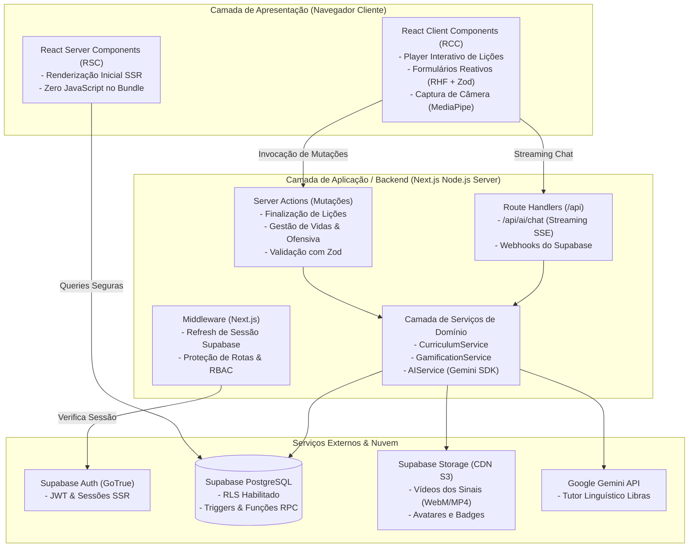
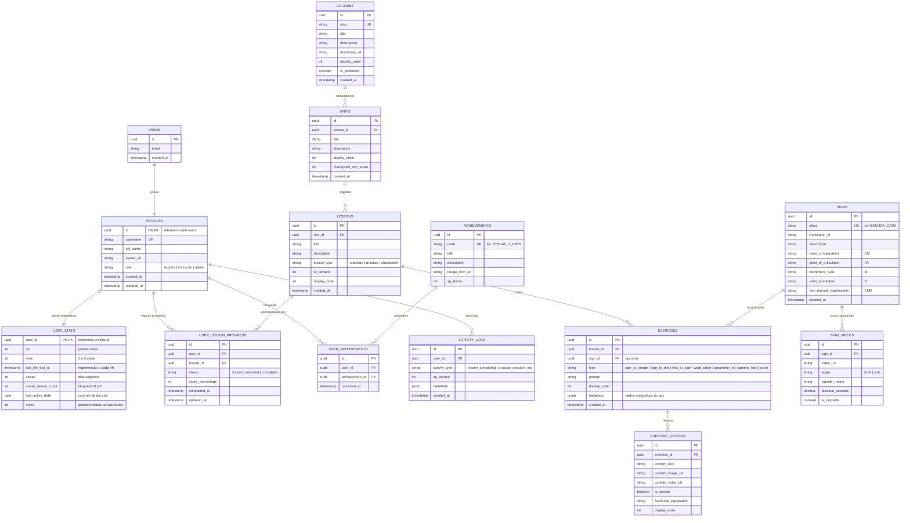
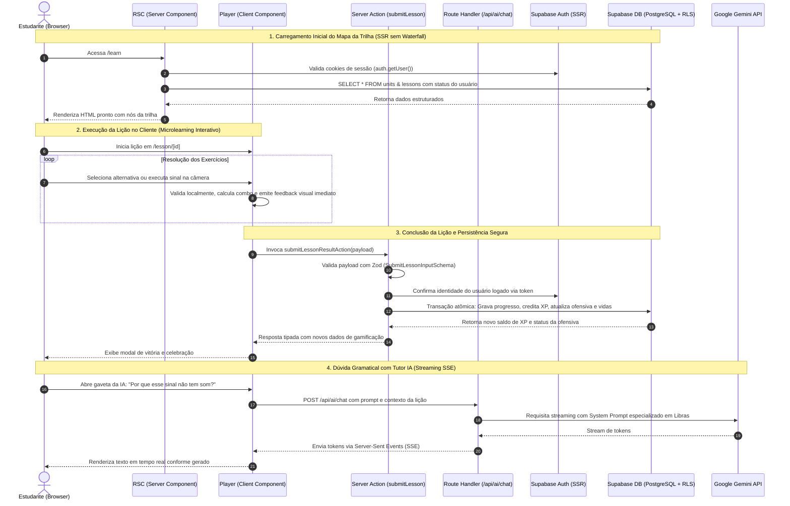

# Arquitetura Técnica de Software: Plataforma Web Gamificada para Ensino de Libras

**Projeto:** Plataforma Web Educacional Gamificada de Libras  
**Stack Principal:** Next.js (App Router), TypeScript, Tailwind CSS, shadcn/ui, Supabase (PostgreSQL, Auth, Storage), Zod, React Hook Form  
**Domínio:** Engenharia de Software e IHC em Ciência da Computação  
**Status:** Arquitetura Técnica e Especificação de Projeto (Pré-Implementação)  

---

## 1. Visão Geral da Arquitetura Técnica

A arquitetura do sistema foi projetada seguindo os princípios de **Clean Architecture**, **Separação de Preocupações (SoC)** e **Arquitetura Orientada a Funcionalidades (*Feature-Driven Development - FDD*)**, adaptada aos paradigmas modernos do **Next.js App Router** (React Server Components, Server Actions e Client Components).

O objetivo é proporcionar um sistema desacoplado, manutenível por uma equipe acadêmica, altamente performático e escalável, sem sobrecarregar componentes visuais com lógica de negócio ou queries de banco de dados.



---

## 2. Diagrama Entidade-Relacionamento (DER)

O modelo relacional foi projetado para garantir integridade referencial, histórico de aprendizagem e alto desempenho em consultas frequentes (como cálculo de ofensiva e validação de pré-requisitos de lições):



---

## 3. Dicionário de Dados e Descrição das Tabelas

### 3.1 Tabela `public.profiles`
Estende os dados de autenticação nativos do Supabase (`auth.users`).
- `id` (UUID, PK, FK `auth.users.id` ON DELETE CASCADE): Identificador unívoco do usuário.
- `username` (VARCHAR(30), UNIQUE, NOT NULL): Apelido de exibição amigável (sem espaços ou caracteres especiais).
- `full_name` (TEXT, NOT NULL): Nome completo do estudante/instrutor.
- `avatar_url` (TEXT, NULL): URL da imagem do avatar no bucket `avatars` do Supabase Storage.
- `role` (VARCHAR(15), NOT NULL, DEFAULT 'student'): Papel de acesso (`student`, `instructor`, `admin`).
- `created_at` (TIMESTAMPTZ, DEFAULT NOW()).
- `updated_at` (TIMESTAMPTZ, DEFAULT NOW()).

### 3.2 Tabela `public.user_stats`
Armazena os parâmetros dinâmicos da gamificação de cada aluno com acesso rápido e atômico.
- `user_id` (UUID, PK, FK `profiles.id` ON DELETE CASCADE).
- `xp` (INTEGER, NOT NULL, DEFAULT 0, CHECK (xp >= 0)): Saldo acumulado de pontos de experiência.
- `lives` (INTEGER, NOT NULL, DEFAULT 5, CHECK (lives >= 0 AND lives <= 5)): Saldo de corações/vidas.
- `last_life_lost_at` (TIMESTAMPTZ, NULL): Carimbo de tempo do momento da última perda de vida para cálculo da regeneração passiva (1 vida a cada 4 horas).
- `streak` (INTEGER, NOT NULL, DEFAULT 0, CHECK (streak >= 0)): Contagem de dias seguidos cumprindo a meta de estudos.
- `streak_freeze_count` (INTEGER, NOT NULL, DEFAULT 0, CHECK (streak_freeze_count BETWEEN 0 AND 2)): Bloqueios de ofensiva disponíveis.
- `last_active_date` (DATE, NULL): Último dia civil em que o aluno completou uma lição válida (baseado no fuso horário do usuário).
- `coins` (INTEGER, NOT NULL, DEFAULT 0, CHECK (coins >= 0)): Moedas virtuais conquistadas por desempenho pedagógico.

### 3.3 Tabela `public.courses`
Catálogo de macro-trilhas de ensino.
- `id` (UUID, PK, DEFAULT `gen_random_uuid()`).
- `slug` (VARCHAR(50), UNIQUE, NOT NULL): Identificador de URL (ex.: `libras-iniciante-1`).
- `title` (TEXT, NOT NULL): Título do curso (ex.: "Libras Básico I — Fundamentos e Comunicação").
- `description` (TEXT, NULL): Ementa e objetivos pedagógicos.
- `thumbnail_url` (TEXT, NULL): Imagem de capa.
- `display_order` (INTEGER, NOT NULL, DEFAULT 1): Ordem na listagem de cursos.
- `is_published` (BOOLEAN, NOT NULL, DEFAULT false): Flag de visibilidade pública.

### 3.4 Tabela `public.units`
Unidades temáticas estruturantes (ilhas de conteúdo no mapa).
- `id` (UUID, PK, DEFAULT `gen_random_uuid()`).
- `course_id` (UUID, NOT NULL, FK `courses.id` ON DELETE CASCADE).
- `title` (TEXT, NOT NULL): Ex.: "Unidade 1: Alfabeto Manual e Datilologia".
- `description` (TEXT, NULL): Resumo das competências desenvolvidas.
- `display_order` (INTEGER, NOT NULL): Posição ordinal no mapa visual da trilha.
- `checkpoint_min_score` (INTEGER, NOT NULL, DEFAULT 80): Pontuação mínima exigida na avaliação final para desbloquear a unidade seguinte.

### 3.5 Tabela `public.lessons`
Lições de microlearning (nós do mapa da trilha).
- `id` (UUID, PK, DEFAULT `gen_random_uuid()`).
- `unit_id` (UUID, NOT NULL, FK `units.id` ON DELETE CASCADE).
- `title` (TEXT, NOT NULL): Ex.: "Letras A a M".
- `description` (TEXT, NULL): Dicas de estudo e contexto fonológico.
- `lesson_type` (VARCHAR(20), NOT NULL, DEFAULT 'standard', CHECK (lesson_type IN ('standard', 'practice', 'checkpoint'))).
- `xp_reward` (INTEGER, NOT NULL, DEFAULT 10): XP concedido ao concluir a lição com sucesso.
- `display_order` (INTEGER, NOT NULL): Sequência de progressão dentro da unidade.

### 3.6 Tabela `public.signs`
Catálogo linguístico dos sinais em Libras e seus 5 parâmetros fonológicos.
- `id` (UUID, PK, DEFAULT `gen_random_uuid()`).
- `gloss` (TEXT, UNIQUE, NOT NULL): Transcrição em glosa em caixa alta (ex.: `BOM-DIA`, `NÃO-GOSTAR`, `A`).
- `translation_pt` (TEXT, NOT NULL): Tradução equivalente contextual em Português.
- `description` (TEXT, NULL): Explicação detalhada de uso cultural e pragmático.
- `hand_configuration` (TEXT, NULL): Notação da Configuração de Mão (CM).
- `point_of_articulation` (TEXT, NULL): Região anatômica da execução (PA).
- `movement_type` (TEXT, NULL): Tipo e direção do movimento (M).
- `palm_orientation` (TEXT, NULL): Orientação espacial da palma (O).
- `non_manual_expressions` (TEXT, NULL): Marcações faciais/corporais obrigatórias (ENM).

### 3.7 Tabela `public.sign_videos`
Vídeos demonstrativos em alta definição gravados por sinalizadores surdos.
- `id` (UUID, PK, DEFAULT `gen_random_uuid()`).
- `sign_id` (UUID, NOT NULL, FK `signs.id` ON DELETE CASCADE).
- `video_url` (TEXT, NOT NULL): Caminho absoluto/relativo no Supabase Storage (ex.: `videos/signs/bom_dia_front.webm`).
- `angle` (VARCHAR(15), NOT NULL, DEFAULT 'front', CHECK (angle IN ('front', 'side', 'three_quarters'))): Ângulo de câmera.
- `signaler_name` (TEXT, NULL): Crédito do instrutor surdo que gravou o sinal.
- `duration_seconds` (NUMERIC(4,2), NOT NULL): Duração do clipe em segundos.
- `is_loopable` (BOOLEAN, NOT NULL, DEFAULT true): Indica se o clipe suporta repetição contínua fluida.

### 3.8 Tabela `public.exercises`
Exercícios atômicos que compõem cada lição.
- `id` (UUID, PK, DEFAULT `gen_random_uuid()`).
- `lesson_id` (UUID, NOT NULL, FK `lessons.id` ON DELETE CASCADE).
- `sign_id` (UUID, NULL, FK `signs.id` ON DELETE SET NULL): Sinal de referência (quando aplicável).
- `type` (VARCHAR(30), NOT NULL, CHECK (type IN ('sign_to_image', 'sign_to_text', 'text_to_sign', 'word_order', 'parameter_id', 'camera_hand_pose'))).
- `prompt` (TEXT, NOT NULL): Enunciado da questão (ex.: "Qual sinal corresponde à imagem abaixo?").
- `display_order` (INTEGER, NOT NULL): Ordem de exibição do exercício na sessão.
- `metadata` (JSONB, NULL): Configurações extras dinâmicas (ex.: `{ "target_letter": "A", "confidence_threshold": 0.85 }` para reconhecimento por câmera, ou `{ "shuffled_tokens": ["CASA", "MINHA", "ONDE?"] }` para ordenação sintática).

### 3.9 Tabela `public.exercise_options`
Alternativas de resposta associadas a cada exercício.
- `id` (UUID, PK, DEFAULT `gen_random_uuid()`).
- `exercise_id` (UUID, NOT NULL, FK `exercises.id` ON DELETE CASCADE).
- `content_text` (TEXT, NULL): Texto da opção (para questões textuais).
- `content_image_url` (TEXT, NULL): Imagem ilustrativa da opção.
- `content_video_url` (TEXT, NULL): Vídeo demonstrativo da opção.
- `is_correct` (BOOLEAN, NOT NULL, DEFAULT false): Flag indicadora de resposta correta.
- `feedback_explanation` (TEXT, NULL): Explicação pedagógica detalhada exibida ao usuário (ex.: "Atenção: Este sinal utiliza a mão em 'S' e não em 'A'").
- `display_order` (INTEGER, NOT NULL, DEFAULT 1).

### 3.10 Tabela `public.user_lesson_progress`
Registro do estado de cada lição para cada aluno.
- `id` (UUID, PK, DEFAULT `gen_random_uuid()`).
- `user_id` (UUID, NOT NULL, FK `profiles.id` ON DELETE CASCADE).
- `lesson_id` (UUID, NOT NULL, FK `lessons.id` ON DELETE CASCADE).
- `status` (VARCHAR(15), NOT NULL, DEFAULT 'locked', CHECK (status IN ('locked', 'unlocked', 'completed'))).
- `score_percentage` (INTEGER, NOT NULL, DEFAULT 0, CHECK (score_percentage BETWEEN 0 AND 100)).
- `completed_at` (TIMESTAMPTZ, NULL).
- `updated_at` (TIMESTAMPTZ, DEFAULT NOW()).
- *Constraint:* `UNIQUE(user_id, lesson_id)`.

### 3.11 Tabelas de Conquistas e Logs: `achievements`, `user_achievements` e `activity_logs`
- `achievements`: Lista de insígnias fixas (`code`, `title`, `description`, `badge_icon_url`, `xp_bonus`).
- `user_achievements`: Registro de medalhas conquistadas pelo usuário (`user_id`, `achievement_id`, `unlocked_at`).
- `activity_logs`: Rastro histórico de auditoria e cálculo de engajamento diário (`user_id`, `activity_type`, `xp_earned`, `metadata`, `created_at`).

---

## 4. Políticas de Segurança com Row Level Security (RLS)

O Supabase PostgreSQL opera com **RLS ativado obrigatoriamente** em todas as tabelas públicas (`ALTER TABLE <tabela> ENABLE ROW LEVEL SECURITY;`), garantindo que nenhuma requisição não autorizada acerte o banco:

```sql
-- 1. PROFILES
-- Leitura pública para usuários autenticados (necessário para rankings/comunidade)
CREATE POLICY "Profiles são visíveis por usuários autenticados"
ON public.profiles FOR SELECT
TO authenticated
USING (true);

-- Atualização restrita ao próprio dono da conta
CREATE POLICY "Usuário só atualiza o próprio perfil"
ON public.profiles FOR UPDATE
TO authenticated
USING (auth.uid() = id)
WITH CHECK (auth.uid() = id);

-- 2. USER_STATS
-- O usuário só lê suas próprias estatísticas vitais
CREATE POLICY "Usuário lê suas próprias estatísticas"
ON public.user_stats FOR SELECT
TO authenticated
USING (auth.uid() = user_id);

-- Atualizações em user_stats são efetuadas exclusivamente via Server Actions autenticadas
CREATE POLICY "Usuário atualiza suas estatísticas via contexto autenticado"
ON public.user_stats FOR UPDATE
TO authenticated
USING (auth.uid() = user_id)
WITH CHECK (auth.uid() = user_id);

-- 3. CONTEÚDO PEDAGÓGICO (COURSES, UNITS, LESSONS, SIGNS, SIGN_VIDEOS, EXERCISES)
-- Leitura permitida para qualquer usuário autenticado (ou anônimo para cursos publicados)
CREATE POLICY "Cursos publicados são visíveis por todos"
ON public.courses FOR SELECT
TO authenticated, anon
USING (is_published = true);

CREATE POLICY "Unidades e Lições legíveis por autenticados"
ON public.units FOR SELECT
TO authenticated
USING (true);

CREATE POLICY "Exercícios legíveis por autenticados"
ON public.exercises FOR SELECT
TO authenticated
USING (true);

-- Inserção/Edição de Conteúdo: Apenas Administradores e Instrutores
CREATE POLICY "Apenas admin e instrutores editam currículo"
ON public.lessons FOR ALL
TO authenticated
USING (
  EXISTS (
    SELECT 1 FROM public.profiles
    WHERE profiles.id = auth.uid() AND profiles.role IN ('admin', 'instructor')
  )
);

-- 4. USER_LESSON_PROGRESS
-- Totalmente isolado por usuário
CREATE POLICY "Usuário visualiza seu próprio progresso"
ON public.user_lesson_progress FOR SELECT
TO authenticated
USING (auth.uid() = user_id);

CREATE POLICY "Usuário insere seu próprio progresso"
ON public.user_lesson_progress FOR INSERT
TO authenticated
WITH CHECK (auth.uid() = user_id);

CREATE POLICY "Usuário atualiza seu próprio progresso"
ON public.user_lesson_progress FOR UPDATE
TO authenticated
USING (auth.uid() = user_id)
WITH CHECK (auth.uid() = user_id);
```

---

## 5. Estrutura de Diretórios Proposta

A estrutura adota o padrão **Feature-Driven Architecture** dentro das convenções oficiais do Next.js App Router:

```
projeto-aprender-libras/
├── .env.example                       # Documentação de variáveis de ambiente obrigatórias
├── .env.local                         # Variáveis locais (não versionadas)
├── components.json                    # Configuração oficial do shadcn/ui
├── middleware.ts                      # Proteção de rotas e refresh de sessão Supabase
├── next.config.ts                     # Configuração de headers, imagens e CSP
├── package.json
├── tailwind.config.ts
├── tsconfig.json
├── docs/                              # Documentações de engenharia e planejamento
│   ├── PLANEJAMENTO_SISTEMA_LIBRAS.md
│   └── ARQUITETURA_TECNICA_LIBRAS.md
└── src/
    ├── app/                           # Camada de Roteamento (Next.js App Router)
    │   ├── (auth)/                    # Grupo de rotas públicas de autenticação
    │   │   ├── login/page.tsx
    │   │   ├── register/page.tsx
    │   │   └── layout.tsx
    │   ├── (dashboard)/               # Grupo de rotas autenticadas com layout padrão
    │   │   ├── layout.tsx             # Shell com Sidebar, mascote, vidas, streak e XP
    │   │   ├── learn/page.tsx         # Mapa da trilha de aprendizado (Ilhas de nós)
    │   │   ├── dictionary/page.tsx    # Glossário de sinais aprendidos com busca
    │   │   ├── profile/page.tsx       # Perfil do aluno, estatísticas e conquistas
    │   │   └── shop/page.tsx          # Loja virtual (Bloqueios de ofensiva e avatares)
    │   ├── lesson/                    # Rota imersiva de execução de lições
    │   │   └── [lessonId]/
    │   │       ├── layout.tsx         # Layout focado (sem sidebar, barra de progresso no topo)
    │   │       └── page.tsx           # Player interativo da lição
    │   ├── api/                       # Route Handlers do servidor (APIs internas)
    │   │   ├── ai/
    │   │   │   └── chat/route.ts      # Streaming de respostas do Tutor IA com Gemini SDK
    │   │   └── webhooks/
    │   │       └── supabase/route.ts  # Webhooks opcionais de sincronização
    │   ├── layout.tsx                 # Root Layout (Fontes, Providers de Tema e Acessibilidade)
    │   ├── page.tsx                   # Landing page pública de apresentação do produto
    │   └── not-found.tsx
    │
    ├── components/                    # Componentes Visuais Compartilhados
    │   ├── ui/                        # Componentes primitivos do shadcn/ui
    │   │   ├── button.tsx
    │   │   ├── dialog.tsx
    │   │   ├── progress.tsx
    │   │   ├── badge.tsx
    │   │   ├── avatar.tsx
    │   │   └── toast.tsx
    │   ├── common/                    # Componentes reutilizáveis de alto nível
    │   │   ├── VideoPlayer.tsx        # Player otimizado com loop, controle de velocidade e sem áudio
    │   │   ├── SignCard.tsx           # Card ilustrativo de sinal com glosa e parâmetros
    │   │   └── FeedbackBanner.tsx     # Banner visual de acerto/erro (não dependente de som)
    │   └── layout/                    # Componentes de estrutura de tela
    │       ├── AppSidebar.tsx
    │       ├── TopStatsBar.tsx        # Barra superior com Vidas, Ofensiva e XP
    │       └── MobileNav.tsx
    │
    ├── features/                      # Módulos Funcionais de Negócio (Feature-Driven)
    │   ├── auth/                      # Autenticação e Perfis
    │   │   ├── components/            # LoginForm, RegisterForm, OAuthButtons
    │   │   ├── hooks/                 # useUserSession
    │   │   └── actions/               # loginAction, registerAction, logoutAction
    │   ├── curriculum/                # Gestão Curricular e Mapa da Trilha
    │   │   ├── components/            # CourseMap, UnitIsland, LessonNode, LockModal
    │   │   ├── hooks/                 # useCourseProgress
    │   │   └── actions/               # getCurriculumDataAction
    │   ├── lesson-player/             # Motor de Execução de Lições e Exercícios
    │   │   ├── components/
    │   │   │   ├── ExerciseRenderer.tsx   # Switch dinâmico de tipo de exercício
    │   │   │   ├── SignToImageExercise.tsx
    │   │   │   ├── SignToTextExercise.tsx
    │   │   │   ├── WordOrderExercise.tsx
    │   │   │   ├── CameraPoseExercise.tsx # Componente de integração com webcam
    │   │   │   └── VictoryModal.tsx       # Tela comemorativa de fim de lição
    │   │   ├── hooks/                 # useLessonEngine (estado de acertos, vidas locais, combo)
    │   │   └── actions/               # submitLessonResultAction (validação e persistência server-side)
    │   ├── gamification/              # Vidas, Streaks, XP e Conquistas
    │   │   ├── components/            # LivesCounter, StreakBadge, HeartRegenerationCountdown
    │   │   ├── hooks/                 # useGamificationStats
    │   │   └── actions/               # recoverLifeAction, buyFreezeAction
    │   ├── ai-tutor/                  # Assistente Pedagógico com IA
    │   │   ├── components/            # AITutorDrawer, ChatBubble, QuickHelpButton
    │   │   └── hooks/                 # useAIChatStream (leitura de ReadableStream SSE)
    │   └── vision/                    # Reconhecimento Visual de Mãos (MediaPipe Client-Side)
    │       ├── components/            # CameraFeed, HandOverlayCanvas, SkeletonGuide
    │       ├── hooks/                 # useMediaPipeHand (carregamento WASM e inferência local)
    │       └── utils/                 # landmarkGeometry.ts, gestureClassifier.ts
    │
    ├── services/                      # Serviços de Domínio e Integrações Externas
    │   ├── supabase/                  # Clientes Supabase SSR oficiais
    │   │   ├── client.ts              # createBrowserClient (para Client Components)
    │   │   ├── server.ts              # createServerClient (para Server Components e Server Actions)
    │   │   └── middleware.ts          # createServerClient utilitário para Next.js Middleware
    │   ├── ai/
    │   │   ├── gemini.service.ts      # Cliente Google Generative AI (Node.js SDK)
    │   │   └── librasprompt.ts        # System Prompt especializado com regras gramaticais da Libras
    │   ├── gamification/
    │   │   └── streak-calculator.ts   # Lógica pura de cálculo de dias de ofensiva e fuso horário
    │   └── storage/
    │       └── video-storage.ts       # Resolução de URLs públicas e cache headers
    │
    ├── hooks/                         # Hooks utilitários globais
    │   ├── useA11ySettings.ts         # Preferências de alto contraste e vibração háptica
    │   └── useMediaQuery.ts
    │
    ├── lib/                           # Utilitários e configurações puras
    │   ├── utils.ts                   # Função `cn()` (clsx + tailwind-merge)
    │   ├── constants.ts               # Limites de vidas (5), XP base (10), tempo de regeneração (4h)
    │   └── date.ts                    # Utilitários de data e fusos horários
    │
    ├── schemas/                       # Schemas de validação Zod (Single Source of Truth)
    │   ├── auth.schema.ts             # LoginSchema, RegisterSchema
    │   ├── lesson.schema.ts           # SubmitLessonInputSchema
    │   ├── profile.schema.ts          # UpdateProfileSchema
    │   └── ai.schema.ts               # AIChatInputSchema
    │
    └── types/                         # Tipagens TypeScript
        ├── database.types.ts          # Tipos gerados automaticamente via Supabase CLI
        ├── curriculum.types.ts        # Interfaces de Curso, Unidade, Lição e Exercício
        ├── gamification.types.ts      # Interfaces de Vidas, Streak e Conquistas
        └── vision.types.ts            # Tipos de Landmarks e coordenadas do MediaPipe
```

---

## 6. Fluxo de Comunicação: Frontend, Backend e Banco



---

## 7. Estratégia de Autenticação e Autorização

### 7.1 Autenticação Baseada em Sessões SSR (`@supabase/ssr`)
- O fluxo de autenticação utiliza o pacote oficial **`@supabase/ssr`**, que encapsula tokens JWT em **cookies HTTP-only, Secure e SameSite=Lax**.
- Isso elimina o risco de vazamento de credenciais via ataques de XSS (Cross-Site Scripting), já que o JavaScript do cliente não tem acesso direto aos cookies da sessão.
- O arquivo `src/middleware.ts` intercepta todas as requisições, renova automaticamente o token de acesso caso esteja expirado (*token refresh*) e redireciona usuários não autenticados que tentarem acessar rotas protegidas (como `/learn`, `/profile` e `/lesson/*`).

### 7.2 Autorização Baseada em Papéis (RBAC - Role-Based Access Control)
- Cada usuário possui um papel definido na tabela `public.profiles`:
  - `student`: Acesso padrão de aprendizagem, lições, loja e perfil próprio.
  - `instructor`: Permissão adicional para cadastrar/editar sinais no glossário e submeter vídeos demonstrativos para aprovação.
  - `admin`: Acesso irrestrito a gerenciamento de usuários, publicação de cursos e configurações de gamificação.
- A verificação de papéis é aplicada de ponta a ponta:
  - No **Middleware** para bloqueio de rotas administrativas (`/admin/*`).
  - Nas **Server Actions** antes de efetuar qualquer operação de escrita.
  - No **PostgreSQL via RLS** como última linha intransponível de defesa.

---

## 8. Estratégia de Segurança e Privacidade

1. **Proteção Total por Row Level Security (RLS):**
   - Nenhuma tabela do banco de dados permite leitura ou escrita cega. O `auth.uid()` provido pelo Supabase no contexto da conexão garante que um estudante jamais acesse ou modifique o progresso, vidas ou XP de outro usuário.

2. **Validação de Entrada Estrita com Zod:**
   - Todas as Server Actions e Route Handlers validam os dados recebidos com schemas Zod antes de qualquer processamento.
   - Entradas maliciosas (como tentativas de injeção de XP exorbitante ou IDs forjados) são rejeitadas imediatamente no servidor com erro 400.

3. **Privacidade Absoluta de Imagens e Câmera (LGPD e Conformidade Ética):**
   - O módulo de Visão Computacional (MediaPipe) é executado **exclusivamente na memória temporária do navegador do cliente (Client-Side Edge Computing)**.
   - Nenhum frame de vídeo, captura de webcam ou imagem do usuário é transmitido para os servidores da aplicação ou para o Supabase. Apenas a resposta booleana de validação local é considerada no fluxo do exercício.

4. **Isolamento de Chaves Privadas e Segredos:**
   - A chave de serviço administrativa do Supabase (`SUPABASE_SERVICE_ROLE_KEY`) e a chave do Google Gemini (`GEMINI_API_KEY`) permanecem estritamente no ambiente do servidor (Node.js), sem qualquer prefixo `NEXT_PUBLIC_`.
   - As requisições de IA passam obrigatoriamente pelo Route Handler `/api/ai/chat`, impedindo que os usuários inspecionem ou utilizem as chaves em aplicações terceiras.

5. **Rate Limiting em Chamadas de IA:**
   - O Route Handler `/api/ai/chat` conta com controle de taxa de requisições por IP e por `user_id` para evitar abusos de cota e ataques de negação de serviço.

---

## 9. Estratégia de Mídia e Armazenamento (Supabase Storage)

1. **Organização dos Buckets:**
   - Bucket `signs-videos`: Armazena vídeos em formatos leves (**WebM com codec VP9** e **MP4 com codec H.264** para compatibilidade universal com iOS/Safari), otimizados para reprodução instantânea com bitrate controlado (< 2 MB por clipe).
   - Bucket `avatars`: Armazena fotos de perfil dos alunos com redimensionamento automático para até 256x256 pixels.
   - Bucket `badges`: Ícones SVG e PNG de medalhas e conquistas.

2. **Políticas de Acesso do Storage:**
   - `signs-videos`: Leitura pública (*public bucket* com cache CDN habilitado por cabeçalhos `Cache-Control: public, max-age=31536000`), permitindo que vídeos comuns sejam cacheados pelo navegador e na borda da rede.
   - Upload restrito a usuários com papel `admin` ou `instructor`.

---

## 10. Conclusão da Especificação Arquitetural

Esta arquitetura técnica viabiliza um desenvolvimento estruturado, profissional e escalável:
- Separa rigorosamente responsabilidades entre UI, regras de negócio e persistência.
- Otimiza custos de infraestrutura e viabiliza a execução gratuita na camada *free-tier* do Supabase e Vercel.
- Respeita o padrão acadêmico de projetos de conclusão de curso em Ciência da Computação.
