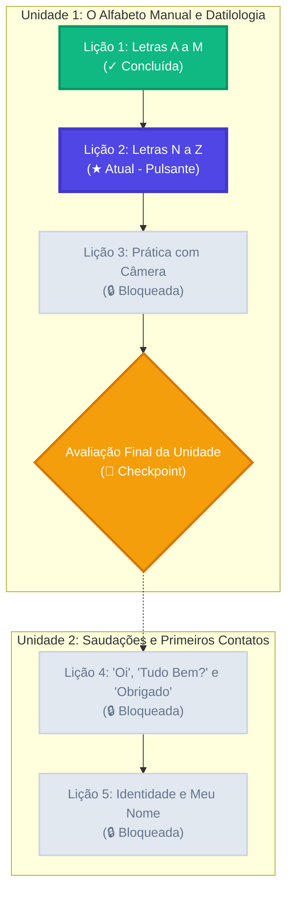

# Proposta de Design UI/UX e Design System: Plataforma "Sinaliza"

**Projeto:** Plataforma Web Gamificada de Ensino de Libras  
**Conceito de Marca:** **Sinaliza** — Conectando Mundos pelas Mãos  
**Metodologia:** Visual-First Gamified Microlearning & Inclusive Design  
**Referência de Engenharia:** WCAG 2.1 Nível AA, e-MAG e Heurísticas de Usabilidade de Nielsen  
**Status:** Proposta de Identidade Visual e Especificação de Interfaces  

---

## 1. Identidade Visual e Conceito de Marca

### 1.1 Posicionamento e Personalidade da Marca
O nome proposto para a plataforma é **Sinaliza**.  
A identidade visual afasta-se deliberadamente de designs corporativos frios ou dashboards administrativos genéricos, adotando uma linguagem visual **acolhedora, dinâmica, altamente visual e tátil**.

- **Valores da Marca:** Acessibilidade, Inclusão, Empatia, Diversão Pedagógica e Rigor Linguístico.
- **Tom de Voz:** Encorajador, claro, empático, descomplicado e visualmente expressivo.
- **Mascote da Plataforma:** **Tico**, um amigável e expressivo macaco-prego (ou quati) brasileiro estilizado, com mãos bem desenhadas e expressividade facial acentuada. O mascote atua como guia visual na trilha, comemorando acertos, incentivando nos erros e demonstrando saudações em Libras.

```
       ┌────────────────────────────────────────────────────────┐
       │   "Sinaliza: Onde cada gesto aproxima pessoas."        │
       │   - 100% Visual-First (Libras é viso-espacial)         │
       │   - Microinterações Táteis (Sensação de jogo real)     │
       │   - Acessibilidade Nativa sem dependência de áudio     │
       └────────────────────────────────────────────────────────┘
```

---

## 2. Design System: Tokens Visuais

### 2.1 Paleta de Cores Harmônica e Inclusiva
As cores foram calibradas para garantir **contraste mínimo de 4.5:1** (WCAG AA) para textos e elementos interativos, evitando paletas puramente verdes e vermelhas que possam prejudicar usuários com daltonismo (adicionando ícones e padrões táteis de apoio).

| Token | Nome da Cor | Hexadecimal | Tailwind Class | Significado e Uso |
|---|---|---|---|---|
| `brand-primary` | Índigo Libras | `#4F46E5` | `bg-indigo-600` | Cor de destaque primária da marca; botões principais, links e foco. |
| `brand-primary-hover` | Índigo Vibrante | `#4338CA` | `bg-indigo-700` | Estado *hover* de botões de ação primária. |
| `brand-primary-light` | Lavanda Suave | `#EEF2FF` | `bg-indigo-50` | Fundos destacados de cards e seleções ativas. |
| `brand-accent` | Âmbar Ensolarado | `#F59E0B` | `bg-amber-500` | Elementos de gamificação: Chamas de ofensiva (*streak*), moedas e estrelas. |
| `brand-accent-light` | Ouro Claro | `#FEF3C7` | `bg-amber-100` | Banners de alerta amigável e conquistas. |
| `success` | Verde Esmeralda | `#10B981` | `bg-emerald-500` | Feedback de acerto, nós de lições concluídas e barras de progresso cheias. |
| `success-light` | Menta Acolhedor | `#ECFDF5` | `bg-emerald-50` | Banner inferior de resposta correta no player. |
| `danger` | Coral Carmesim | `#EF4444` | `bg-rose-500` | Corações de vida, feedback de erro e alertas de esgotamento. |
| `danger-light` | Rosa Alerta | `#FFF1F2` | `bg-rose-50` | Banner inferior de resposta incorreta no player. |
| `surface-bg` | Areia Neutro | `#F8FAFC` | `bg-slate-50` | Fundo principal da aplicação (reduz fadiga ocular em relação ao branco puro). |
| `surface-card` | Branco Puro | `#FFFFFF` | `bg-white` | Superfície dos cards elevados, modais e containers. |
| `text-primary` | Grafite Profundo | `#0F172A` | `text-slate-900` | Títulos, enunciados e textos principais (contraste 14:1). |
| `text-secondary` | Ardósia Suave | `#475569` | `text-slate-600` | Subtítulos, metadados fonológicos e rótulos secundários. |
| `border-subtle` | Cinza Contorno | `#E2E8F0` | `border-slate-200` | Bordas padrão de cartões e divisores. |

### 2.2 Estilo de Botões "Neo-Brutalism Suave / Tátil 3D"
Para evocar o prazer físico de clicar em botões de jogos (semelhante ao Duolingo, mas com estética contemporânea):
- **Borda inferior elevada:** `border-b-4` permanente que confere sensação volumétrica tridimensional.
- **Microinteração de clique:** No estado `:active`, o botão se desloca 2px para baixo (`translate-y-[2px]`) e reduz a borda para `border-b-2`, simulando o afundamento mecânico de uma tecla física.
- **Raios de curvatura:** `rounded-2xl` (16px) em botões e cards de opções, gerando acolhimento e modernidade visual.

### 2.3 Tipografia
- **Títulos e Display:** `Plus Jakarta Sans` ou `Nunito` (700 Bold e 800 ExtraBold). Formas geométricas arredondadas, amigáveis e com personalidade marcante.
- **Corpo e Interface:** `Plus Jakarta Sans` ou `Inter` (400 Regular, 500 Medium, 600 SemiBold). Excelente distinção de caracteres (como `l` minúsculo e `I` maiúsculo), alta legibilidade em telas compactas e espaçamento de glosa otimizado.

---

## 3. Especificação do Layout Principal

A estrutura da aplicação divide-se em um **Shell de Navegação Adaptativo**:

```
+---------------------------------------------------------------------------------------+
|  LOGO & SINALIZA    |   [♥ 5 Vidas]   [🔥 12 Dias]   [⚡ 340 XP]   |  [Avatar & Perfil] |
+---------------------+-----------------------------------------------------------------+
|  [🏠 Início]        |                                                                 |
|  [📖 Aprender] ★    |                 TRILHA DE APRENDIZAGEM                          |
|  [📚 Dicionário]    |                                                                 |
|  [🏆 Conquistas]    |               [ Unidade 1: Alfabeto ]                           |
|  [🛒 Loja]          |                       ( ○ ) Concluída                           |
|  [👤 Perfil]        |                     ╱                                           |
|                     |                  ( ★ ) ATUAL (Pulsante)                         |
|                     |                     ╲                                           |
|                     |                       ( 🔒 ) Bloqueada                          |
|                     |                                                                 |
|                     |               [ Unidade 2: Saudações ]                          |
+---------------------+-----------------------------------------------------------------+
|   (Mobile: Barra inferior de ícones fixada no rodapé da tela com toque confortável)   |
+---------------------------------------------------------------------------------------+
```

### 3.1 Menu Lateral de Navegação (Desktop Sidebar)
- **Posicionamento:** Fixado à esquerda, largura fixa de `260px`, borda divisória suave `border-r border-slate-200`.
- **Identidade:** Logotipo com ícone estilizado de mãos em formato de pássaro/voo e tipografia `Sinaliza`.
- **Itens de Navegação:**
  1. `Início / Trilha` (`/learn`): Ícone de bússola/mapa. Item ativo por padrão com badge visual.
  2. `Dicionário de Sinais` (`/dictionary`): Ícone de livro com sinalizador, acesso rápido aos sinais já dominados.
  3. `Conquistas & Medalhas` (`/achievements`): Ícone de troféu dourado.
  4. `Loja de Recompensas` (`/shop`): Ícone de bauzinho/moedas (compra de congelador de ofensiva).
  5. `Perfil & Estatísticas` (`/profile`): Ícone de avatar com indicador de nível.

### 3.2 Cabeçalho de Gamificação (Top Stats Bar)
Fixado no topo em desktop e mobile, centralizando as métricas vitais que motivam o estudante:
- **Contador de Vidas:** Ícone de coração vermelho 3D (`#EF4444`) com número `5/5`. Tooltip interativo exibe o tempo restante para a próxima regeneração: *"Próxima vida em 02h 45m"* ou botão de *"Recarregar praticando"*.
- **Contador de Ofensiva (*Streak*):** Ícone de chama amarela/laranja cintilante (`#F59E0B`) com o número de dias seguidos (ex.: `14`). Animação sutil de pulso ao abrir o aplicativo.
- **Contador de Experiência (XP):** Ícone de gema/raio azul índigo com o total de pontos acumulados na semana (ex.: `420 XP`).
- **Avatar do Usuário:** Foto circular com anel colorido de progresso do nível atual e menu dropdown de configurações da conta.

---

## 4. Tela da Trilha de Aprendizagem (`/learn`)

A trilha adota o consagrado formato de **"Caminho Orgânico em Nós"**, dispostos em zigue-zague suave, agrupados por **Ilhas de Unidades Temáticas**.



### 4.1 Estados Visuais dos Nós de Lição

1. **Estado Concluído (Dourado / Verde Esmeralda):**
   - Botão circular de 64px com fundo esmeralda brilhante (`bg-emerald-500 border-b-4 border-emerald-700`).
   - Ícone central de checkmark em relevo ou estrela dourada.
   - Pode ser clicado para "Praticar novamente e ganhar +5 XP".

2. **Estado Atual / Ativo (Índigo Vibrante com Anel Pulsante):**
   - Fundo índigo marcante (`bg-indigo-600 border-b-4 border-indigo-800`).
   - Anel de animação pulsante sutil (`ring-4 ring-indigo-300 ring-offset-2 animate-pulse`).
   - Balão de fala flutuante do mascote Tico logo acima do nó: *"Próxima parada! Clique para começar!"*.
   - Ao passar o mouse, exibe card flutuante com título da lição, recompensa prevista (+10 XP) e botão de ação imediato.

3. **Estado Bloqueado (Cinza Suave com Cadeado):**
   - Fundo cinza suave (`bg-slate-200 border-b-4 border-slate-300`).
   - Ícone de cadeado prateado central.
   - Ao clicar, exibe mensagem didática amigável: *"Conclua as lições anteriores para liberar este conteúdo!"*.

4. **Nó de Avaliação (*Checkpoint / Prova da Unidade*):**
   - Nó com formato diferenciado de troféu ou castelo hexagonal dourado (`bg-amber-500 border-b-4 border-amber-700`).
   - Recompensa substancial (+50 XP e medalha de conclusão de unidade).

---

## 5. Tela do Player de Lição (`/lesson/[id]`)

Projetada com foco absoluto na atenção do aluno: **zero elementos de distração lateral**, priorizando a área de observação visual dos sinais em Libras.

```
+---------------------------------------------------------------------------------------+
|  [ ✕ Sair ]   ══════════════════════ [ Barra de Progresso: 60% ] ════════   [ ♥ 4 ]   |
+---------------------------------------------------------------------------------------+
|                                                                                       |
|         Enunciado: "Qual sinal representa a palavra 'BOM-DIA' em Libras?"             |
|                                                                                       |
|                      +---------------------------------------+                        |
|                      |                                       |                        |
|                      |        VÍDEO EM LIBRAS HD             |                        |
|                      |     (Instrutor Surdo Fluente)         |                        |
|                      |                                       |                        |
|                      |   [ 🔁 Loop ]    [ 0.75x Velocidade ] |                        |
|                      +---------------------------------------+                        |
|                                                                                       |
|         Selecione a alternativa correta:                                              |
|                                                                                       |
|         +---------------------------+       +---------------------------+             |
|         | [1]  "Bom Dia"            |       | [2]  "Boa Noite"          |             |
|         | (Selecionado - Borda Roxa)|       |                           |             |
|         +---------------------------+       +---------------------------+             |
|         +---------------------------+       +---------------------------+             |
|         | [3]  "Por Favor"          |       | [4]  "Desculpe"           |             |
|         +---------------------------+       +---------------------------+             |
|                                                                                       |
+---------------------------------------------------------------------------------------+
|  [ 🤖 Tirar Dúvida com Tutor ]                          [  VERIFICAR RESPOSTA  ]      |
+---------------------------------------------------------------------------------------+
```

### 5.1 Especificação dos Componentes da Lição

1. **Player de Vídeo de Sinal em Libras:**
   - Proporção 16:9 ou 4:3, cantos arredondados `rounded-2xl`, moldura estilizada com sombra suave.
   - Pré-carregamento automático com loop contínuo e sem áudio por padrão (respeitando a natureza visual da língua).
   - Botão de velocidade embutido no canto inferior do vídeo: `1.0x` (velocidade natural de conversação), `0.75x` (didática) e `0.5x` (análise detalhada de configuração de mão e ponto de articulação).
   - Botão de alternância de ângulo (frontal e lateral) quando o sinal exigir profundidade tridimensional.

2. **Cards de Alternativas Interativas:**
   - Botões largos com padding confortável (`p-4` a `p-6`), borda espessa `border-2 border-slate-200 border-b-4 hover:border-indigo-400 hover:bg-indigo-50/50`.
   - Teclas de atalho visíveis no canto superior esquerdo do card (`[1]`, `[2]`, `[3]`, `[4]`), permitindo resolução veloz por teclado.
   - Estado Selecionado: `border-indigo-600 bg-indigo-50 border-b-4 border-indigo-700 text-indigo-950 font-semibold`.

3. **Banner Inferior Dinâmico de Feedback:**
   - **Caso Acerto:**
     - Fundo verde menta suave (`bg-emerald-100 border-t-2 border-emerald-300`).
     - Ícone circular com checkmark verde esmeralda.
     - Texto de celebração: *"Excelente! É isso mesmo!"*.
     - Dica linguística em destaque: *"O sinal 'BOM-DIA' inicia com a mão na boca e se abre em direção ao espaço neutro com expressão facial receptiva."*
     - Botão verde vibrante: `CONTINUAR` (acionável por `Enter`).
   - **Caso Erro:**
     - Fundo rosa suave (`bg-rose-100 border-t-2 border-rose-300`).
     - Ícone de coração partido com mensagem empática: *"Quase lá! Resposta correta: 'BOM-DIA'"*.
     - Explicação fonológica: *"Você selecionou 'BOA-NOITE'. Observe que em 'BOA-NOITE' a mão desce cobrindo a outra mão, simbolizando o escurecer."*
     - Botão vermelho coral: `ENTENDI` (acionável por `Enter`).
     - O exercício é automaticamente reenfileirado para o final da lição para fixação garantida.

4. **Botão de Dúvida com Tutor IA:**
   - Botão discreto no rodapé esquerdo: *"Dúvida sobre este sinal? Pergunte ao Tutor"* que abre uma gaveta lateral limpa para esclarecer o uso gramatical ou cultural daquele sinal em tempo real.

---

## 6. Acessibilidade e Inclusão (Diretrizes e Checklist)

1. **Acessibilidade para Pessoas Surdas:**
   - Nenhum evento, aviso, vitória ou erro tem o áudio como canal mandatório ou exclusivo. Todos os sinais sonoros possuem **equivalência visual completa** (banners coloridos, ícones expressivos e animações de confete).
   - Vídeos produzidos com iluminação adequada, roupas lisas e de alto contraste com o tom de pele do sinalizador e fundo neutro para máxima nitidez das configurações de mão.
2. **Navegação 100% por Teclado:**
   - Tecla `1` a `4`: Seleciona as alternativas correspondentes.
   - Tecla `Espaço`: Pausa ou retoma o vídeo em Libras.
   - Tecla `Enter`: Confirma resposta / avança para a próxima tela.
   - Tecla `Esc`: Abre o modal de pausa/saída da lição.
   - Todos os elementos focáveis possuem indicador nítido de foco: `focus-visible:ring-4 focus-visible:ring-indigo-400 focus-visible:outline-none`.
3. **Respeito à Preferência de Movimento Reduzido (`prefers-reduced-motion`):**
   - Transições de tela e animações de comemoração (como confetes e balanços de nó) são desativadas ou simplificadas para fades discretos quando o usuário tiver a opção de movimento reduzido ativada no sistema operacional.
4. **Modo Alto Contraste:**
   - Aumenta a espessura das bordas para 3px sólido e ajusta contrastes de texto para proporções superiores a 7:1 (padrão WCAG AAA).

---

## 7. Próximos Passos de Validação

Esta proposta de identidade e design visual estabelece uma linguagem própria, moderna, livre de imitações proprietárias e perfeitamente sintonizada com as necessidades da comunidade surda e de estudantes ouvintes.

Apresentaremos a seguir o protótipo visual estruturado no artefato interativo para validação visual direta!
