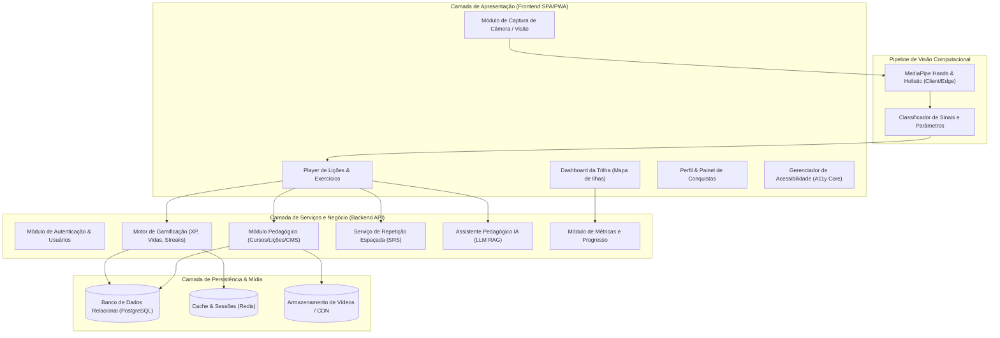
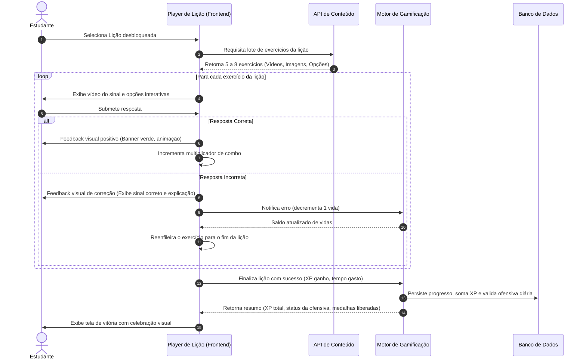
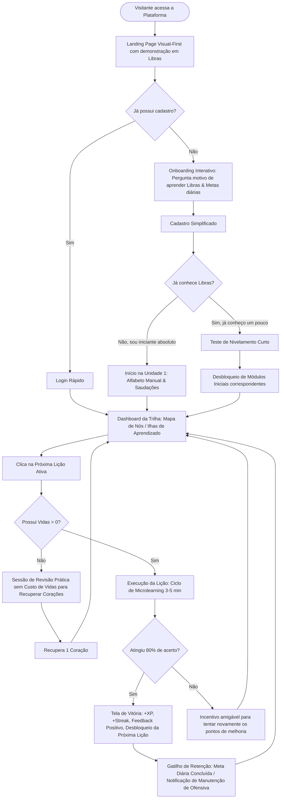

# Especificação de Requisitos e Planejamento Arquitetural: Plataforma Gamificada para Ensino de Libras

**Projeto:** Plataforma Web Educacional Adaptativa para Ensino da Língua Brasileira de Sinais  
**Inspiração Metodológica:** Aprendizagem Ativa e Microlearning Gamificado (padrão Duolingo)  
**Domínio:** Ciência da Computação aplicada à Educação e Acessibilidade (Linguística Computacional e IHC)  
**Status:** Validação de Planejamento e Especificação Pré-Implementação  

---

## 1. Visão Geral e Contextualização do Projeto

### 1.1 Justificativa Acadêmica e Social
A Língua Brasileira de Sinais (Libras), reconhecida legalmente pela **Lei Federal nº 10.436/2002** e regulamentada pelo **Decreto nº 5.626/2005**, é um sistema linguístico legítimo e natural de transmissão espaço-visual, dotado de estrutura gramatical própria. A comunicação entre pessoas surdas e a comunidade ouvinte ainda enfrenta severas barreiras devido à escassez de métodos de ensino acessíveis, intuitivos e engajantes.

O presente projeto propõe uma plataforma web moderna, construída sobre as teorias da **Ciência da Computação**, da **Interação Humano-Computador (IHC)** e da **Gamificação Pedagógica** (baseada no framework Octalysis de Yu-kai Chou e microaprendizagem móvel), garantindo rigor pedagógico e linguístico.

### 1.2 Fundamentação Linguística: A Natureza da Libras
Diferentemente de concepções errôneas populares, a Libras **não é mímica, nem pantomima, tampouco a simples transposição gestual do Português (Português Sinalizado)**. O software é arquitetado para respeitar os **Cinco Parâmetros Fonológicos Quíntuplos da Libras**:

1. **Configuração de Mão (CM):** Forma que a mão assume ao articular o sinal (existem dezenas de configurações catalogadas na literatura linguística de Ferreira Brito e Felipe).
2. **Ponto de Articulação / Locação (PA):** Local do corpo (cabeça, peito, ombro) ou no espaço neutro em frente ao sinalizador onde o sinal é executado.
3. **Movimento (M):** Direção, trajetória, velocidade e frequência das mãos (retilíneo, circular, helicoidal, sinuoso, contínuo ou pontual).
4. **Orientação da Palma (O):** Direção para a qual a palma da mão está voltada (para cima, para baixo, para o corpo, para fora, para a direita ou esquerda).
5. **Expressões Não-Manuais (ENM):** Movimentos de face, olhos, sobrancelhas e postura do tronco. Desempenham papel gramatical distintivo (ex.: diferenciar uma frase afirmativa de uma interrogativa ou exclamativa, além de graduar intensidade).

```
                      ┌──────────────────────────────────────┐
                      │    5 PARÂMETROS FONOLÓGICOS          │
                      │           DA LIBRAS                  │
                      └──────────────────┬───────────────────┘
                                         │
        ┌───────────────┬────────────────┼───────────────┬────────────────┐
        ▼               ▼                ▼               ▼                ▼
┌──────────────┐ ┌──────────────┐ ┌──────────────┐ ┌──────────────┐ ┌──────────────┐
│Configuração  │ │  Ponto de    │ │  Movimento   │ │ Orientação   │ │ Expressões   │
│de Mão (CM)   │ │ Articulação  │ │     (M)      │ │ da Palma (O) │ │ Não-Manuais  │
│              │ │    (PA)      │ │              │ │              │ │    (ENM)     │
└──────────────┘ └──────────────┘ └──────────────┘ └──────────────┘ └──────────────┘
```

Adicionalmente, a sintaxe da Libras prioriza estruturas do tipo **Tópico-Comentário** e ordem preferencial de constituintes flexível (frequentemente **OSV** ou **SOV**), operando no **Espaço Neutro** tridimensional por meio de índices espaciais e **Classificadores (CL)**.

---

## 2. Arquitetura Conceitual e Módulos do Sistema

O sistema é concebido segundo uma arquitetura modular em camadas, garantindo baixo acoplamento e alta coesão:



### 2.1 Descrição dos Módulos

1. **Módulo 1: Autenticação e Gestão de Identidade (Auth & Identity):**
   - Controle de credenciais, fluxo seguro de cadastro, login social (OAuth 2.0), recuperação de senha e gestão de perfil de usuário (nome, avatar, biografia, preferências de acessibilidade e nível de proficiência inicial).

2. **Módulo 2: Gestão Pedagógica e Conteúdo Instrucional (Curriculum Management):**
   - Estrutura hierárquica curricular estrita: **Curso -> Unidade -> Módulo -> Lição -> Exercício -> Avaliação**.
   - Gerenciamento de metadados linguísticos de cada sinal (CM, PA, M, O, ENM, contexto de uso, transcrição em glosa e tradução equivalente em Português).
   - Armazenamento otimizado de mídias (vídeos em alta definição, formato leve como WebM/MP4 codificado em H.264/AV1 com loops fluidos gravados por instrutores surdos fluentes).

3. **Módulo 3: Motor de Gamificação (Gamification Engine):**
   - Sistema de cálculo e atribuição de **Pontos de Experiência (XP)**.
   - Gerenciador de **Vidas/Tentativas** (modelo de corações): decréscimo em erros, regeneração temporal e proteção contra desestímulo.
   - Sistema de **Sequência Diária (Ofensiva / Streak)** com fuso horário ajustável e consumível de congelamento (*Streak Freeze*).
   - Motor de **Conquistas (*Badges*) e Ligas Semanais** (rankings competitivos com base em divisões).

4. **Módulo 4: Reprodutor Interativo de Aulas (Lesson Interactive Player):**
   - Execução do fluxo de microlearning (lições curtas de 3 a 5 minutos).
   - Renderizador dinâmico de diferentes tipos de exercícios com feedback imediato (áudio opcional, vibração tátil em dispositivos móveis e animações visuais acessíveis).
   - Tratamento de estados da lição: introdução de conteúdo novo, fixação, revisão rápida e tela de vitória com sumário de desempenho.

5. **Módulo 5: Visão Computacional e Reconhecimento de Sinais (CV Engine):**
   - Captura e processamento de vídeo via webcam local do usuário sem envio de stream contínuo para servidor (garantindo privacidade e zero latência de rede).
   - Extração de marcos anatômicos tridimensionais das mãos e face através de bibliotecas como **MediaPipe Hands e Holistic**.
   - Classificação vetorial e angular de Configurações de Mão (CM) e Ponto de Articulação (PA) no cliente para validação de exercícios práticos do alfabeto manual e sinais estáticos/dinâmicos.

6. **Módulo 6: Assistente Educacional Baseado em IA (AI Tutor):**
   - Agente conversacional especializado em gramática e cultura surda, operando sob técnica de **RAG (Retrieval-Augmented Generation)** alimentado por gramáticas de referência de Libras.
   - Capacidade de explicar por que determinada construção está incorreta (explicando diferenças sintáticas entre Português e Libras, uso de classificadores e marcações não manuais).
   - Modo de incentivo socioemocional contextualizado ao progresso do estudante.

7. **Módulo 7: Núcleo de Acessibilidade e Inclusão (A11y Core):**
   - Conformidade estrita com as diretrizes internacionais **WCAG 2.1 (nível AA/AAA)** e nacionais (**e-MAG**).
   - Total usabilidade por pessoas surdas: ausência de dependência de som para feedback de acerto/erro. Todos os feedbacks sonoros possuem correspondentes visuais (cores, ícones, microanimações, legendas e avatares expressivos).
   - Modos de Alto Contraste, modo escuro/claro, escalabilidade de fontes, atalhos de teclado completos e compatibilidade com leitores de tela (ARIA labels).

8. **Módulo 8: Analítica e Repetição Espaçada (Learning Analytics & SRS):**
   - Algoritmo baseado em variações do **SuperMemo SM-2** adaptado para aquisição viso-espacial de vocabulário e regras sintáticas.
   - Cálculo automático da curva de esquecimento para programar sessões de revisão periódica de sinais previamente aprendidos.

---

## 3. Regras de Negócio Fundamentais (RN)

| Identificador | Título da Regra | Descrição e Lógica de Aplicação |
|---|---|---|
| **RN-01** | Progressão Pedagógica Sequencial | Uma lição só se torna desbloqueada quando o usuário concluir a lição imediatamente anterior com aproveitamento mínimo de 80%. Unidades subsequentes só são liberadas após a conclusão de todas as lições da unidade atual e aprovação na avaliação final (*Checkpoint*). |
| **RN-02** | Consumo e Esgotamento de Vidas | O usuário padrão inicia com 5 vidas (corações). Cada resposta incorreta em uma lição subtrai 1 vida. Caso o saldo atinja 0, a lição corrente é interrompida, e o usuário é redirecionado para uma sessão de revisão prática sem custo de vidas para recarregar corações. |
| **RN-03** | Regeneração Temporal de Vidas | Cada vida é regenerada automaticamente a cada 4 horas de inatividade, até o limite máximo de 5 vidas. Usuários podem recuperar 1 vida imediatamente ao completar com êxito uma sessão de "Treino de Revisão". |
| **RN-04** | Atribuição de Pontos de Experiência (XP) | Cada lição regular concluída concede 10 XP base. Respostas corretas consecutivas sem erro concedem bônus de combo (+2 a +5 XP). Revisões concedem 5 XP. Sessões com validação por câmera concedem 15 XP devido à maior complexidade cognitiva motora. |
| **RN-05** | Manutenção da Ofensiva Diária (*Streak*) | Para manter a ofensiva ativa, o usuário deve acumular ao menos 10 XP entre 00:00:00 e 23:59:59 no fuso horário local registrado em seu perfil. Se um dia decorrer sem atividade mínima e o usuário não possuir um "Bloqueio de Ofensiva" (*Streak Freeze*) ativo, o contador é zerado. |
| **RN-06** | Mecânica do Congelamento de Ofensiva | O usuário pode adquirir e equipar até 2 "Bloqueios de Ofensiva" utilizando moedas virtuais do jogo (Gemas/LibrasCoins conquistadas por desempenho). O item é consumido automaticamente no primeiro dia de ausência, preservando a contagem de dias seguidos. |
| **RN-07** | Não-Dependência Auditiva nos Feedbacks | É expressamente vedado o uso de estímulos sonoros como canal exclusivo de transmissão de informação ou validação de estado. Todo som de acerto/erro/tempo deve ter correspondente visual inequívoco (ex.: banner verde com checkmark e vibração haptic para acerto; banner vermelho com descrição textual explicativa para erro). |
| **RN-08** | Fidelidade Fonológica dos Sinais | Nenhum sinal em Libras poderá ser apresentado desprovido da exibição em vídeo do contexto de sua execução corporal completa (mãos, torso e face). É proibida a apresentação de sinais recortando apenas a mão quando o sinal demandar expressão facial gramatical (ENM) ou ponto de articulação no tronco/face. |
| **RN-09** | Tolerância e Feedback em Validações Visuais | No exercício com uso de câmera (MediaPipe), o sistema deve avaliar os parâmetros de Configuração de Mão (CM) e Orientação (O) com janela de tolerância adaptativa (threshold de similaridade por distância euclidiana/cosseno de landmarks de no mínimo 85%). Em caso de erro, a interface deve indicar visualmente qual dedo ou orientação está desalinhada. |
| **RN-10** | Repetição Espaçada Obrigatória (SRS) | O sistema deve injetar sinais com status "enfraquecido" (cujo intervalo de tempo calculado pelo algoritmo SRS expirou) nas lições de revisão diária, priorizando-os sobre conteúdos recém-vistos. |
| **RN-11** | Preservação de Privacidade na Câmera | Nenhuma gravação de vídeo, frame contínuo ou fotografia do usuário obtida pela webcam para o exercício de visão computacional poderá ser transmitida, armazenada em disco de servidor ou repassada a terceiros sem consentimento explícito. O processamento dos landmarks deve ocorrer estritamente em tempo real na memória da aba do navegador cliente (Client-side inference). |
| **RN-12** | Atuação Confinada do Tutor IA | O assistente pedagógico por IA deve responder estritamente a questões ligadas à Libras, gramática visual, cultura surda e navegação na plataforma. O prompt de sistema deve rejeitar desvios de finalidade (alucinações ou temas genéricos não relacionados ao aprendizado de Libras). |

---

## 4. Documento de Requisitos Funcionais (RF)

Classificação por priorização metodológica **MoSCoW**:
- **Must Have (Essencial para o MVP)**
- **Should Have (Importante para a experiência completa)**
- **Could Have (Desejável / Diferencial competitivo)**
- **Won't Have (Não prioritário no momento inicial)**

| ID | Nome do Requisito | Descrição Detalhada | Prioridade | Módulo |
|---|---|---|---|---|
| **RF-01** | Cadastro de Usuário | Permitir que o visitante crie uma conta fornecendo Nome, E-mail e Senha (com validação de força), ou via autenticação federada (Google OAuth). | **Must** | M1 |
| **RF-02** | Autenticação e Sessão | Efetuar login seguro com emissão de tokens JWT com expiração e refresh tokens; manter usuário autenticado com persistência local criptografada. | **Must** | M1 |
| **RF-03** | Gestão de Perfil | Permitir ao usuário atualizar foto/avatar, apelido, visualizar estatísticas consolidadas (dias de ofensiva, XP total, lições completas) e alterar senha. | **Must** | M1 |
| **RF-04** | Seleção de Curso e Trilha | Apresentar catálogo de trilhas de aprendizagem (ex.: "Libras Básico I", "Libras para o Cotidiano", "Vocabulário de Saúde"), exibindo percentual de progresso. | **Must** | M2 |
| **RF-05** | Visualização do Mapa de Ilhas | Exibir visualmente a trilha de aprendizagem organizada por Unidades temáticas, com nós de lições desbloqueadas, em andamento, concluídas e bloqueadas. | **Must** | M2 |
| **RF-06** | Player de Vídeo em Libras | Reproduzir vídeos em alta definição demonstrando o sinal em Libras, com controles de velocidade (0.5x, 0.75x, 1x), botão de repetição infinita (loop) e exibição do sinal em múltiplos ângulos (frontal e lateral) quando aplicável. | **Must** | M2/M4 |
| **RF-07** | Exercício: Associação Sinal-Imagem | Apresentar vídeo de um sinal em Libras e uma grade de imagens representativas do significado para seleção direta pelo usuário. | **Must** | M4 |
| **RF-08** | Exercício: Múltipla Escolha Textual | Exibir um sinal em vídeo e 4 alternativas textuais de significados/frases em Português, ou o inverso (texto em Português solicitando o vídeo correspondente). | **Must** | M4 |
| **RF-09** | Exercício: Formação de Frase em Ordem Sintática | Apresentar blocos de palavras/glosas desordenados para que o usuário construa uma sentença respeitando a estrutura gramatical da Libras (Tópico-Comentário). | **Should** | M4 |
| **RF-10** | Exercício: Identificação de Parâmetros | Exibir um sinal e questionar especificamente qual é a Configuração de Mão (CM) ou Ponto de Articulação (PA) utilizado, treinando a consciência fonológica do aluno. | **Should** | M4 |
| **RF-11** | Exercício: Reconhecimento Visual via Câmera | Acessar a webcam do usuário com autorização prévia, exibir guia de enquadramento da mão e validar se o usuário reproduz corretamente a Configuração de Mão solicitada (ex.: letras do alfabeto manual ou saudações estáticas) utilizando MediaPipe. | **Should** | M5 |
| **RF-12** | Sistema de Experiência (XP) | Contabilizar e creditar pontos de XP após cada resposta e consolidar na finalização da lição, exibindo barra de progresso visual animada. | **Must** | M3 |
| **RF-13** | Mecanismo de Vidas / Tentativas | Exibir indicador visual de vidas no cabeçalho do player de lição; debitar vidas em caso de erro e impedir início de lições novas caso o saldo seja 0, orientando para o treino de recuperação. | **Must** | M3 |
| **RF-14** | Contador de Ofensiva Diária (*Streak*) | Registrar e exibir de forma proeminente os dias consecutivos de estudo do usuário com ícone de chama estilizada; alertar quando a ofensiva do dia estiver pendente. | **Must** | M3 |
| **RF-15** | Sistema de Conquistas e Insígnias | Desbloquear medalhas automáticas quando o usuário atingir marcos específicos (ex.: "Primeira Ofensiva de 7 Dias", "Mestre do Alfabeto", "100 Sinais Aprendidos"). | **Should** | M3 |
| **RF-16** | Dicionário Interativo de Sinais (Glossário) | Disponibilizar área de consulta rápida onde o usuário pode buscar qualquer sinal já aprendido, assistir novamente ao vídeo e ler as anotações fonológicas. | **Should** | M2 |
| **RF-17** | Assistente Pedagógico Virtual (Tutor IA) | Disponibilizar chat contextual durante a lição ou em aba dedicada, permitindo ao aluno tirar dúvidas gramaticais, culturais ou de execução corporal de sinais em Libras. | **Should** | M6 |
| **RF-18** | Sistema de Repetição Espaçada (SRS) | Algoritmo que agenda automaticamente revisões de sinais antigos com base no histórico de erros e tempo desde a última prática do usuário. | **Should** | M8 |
| **RF-19** | Ranking Semanal / Ligas Competitivas | Agrupar 30 usuários de níveis similares em uma tabela de classificação semanal baseada no XP adquirido no período, promovendo e rebaixando entre divisões (ex.: Divisão Bronze, Prata, Ouro, Diamante). | **Could** | M3 |
| **RF-20** | Loja Virtual de Recompensas | Permitir ao usuário gastar moedas virtuais acumuladas (adquiridas sem dinheiro real, apenas com dedicação) para comprar itens cosméticos de avatar e Bloqueios de Ofensiva. | **Could** | M3 |
| **RF-21** | Teste de Nivelamento | Avaliação inicial interativa de 10 questões para usuários que já possuem contato prévio com Libras, permitindo desbloquear unidades básicas automaticamente. | **Could** | M2 |
| **RF-22** | Módulo de Feedback por Instrutores | Permitir que o aluno reporte vídeos com possíveis imprecisões ou envie dúvidas específicas para moderação por especialistas e educadores surdos. | **Could** | M2 |
| **RF-23** | Tradutor Bidirecional Completo de Texto para Libras | Tradução aberta e irrestrita de textos em linguagem natural para vídeo sintetizado 3D de Libras em tempo real. | **Won't** *(fora do escopo inicial)* | Out |
| **RF-24** | Reconhecimento de Sentenças Contínuas Dinâmicas Complexas | Reconhecimento por IA de frases longas em fluxo contínuo de vídeo com múltiplos classificadores e expressões faciais simultâneas em tempo real no browser. | **Won't** *(tecnologia experimental / pesquisa de ponta)* | Out |

---

## 5. Documento de Requisitos Não Funcionais (RNF)

| ID | Categoria | Descrição do Requisito | Métrica / Critério de Aceite |
|---|---|---|---|
| **RNF-01** | Usabilidade & IHC | A interface deve adotar o paradigma *Visual-First*. Nenhuma instrução crucial deve depender de texto denso; iconografia e referências visuais devem guiar o usuário com esforço cognitivo mínimo. | Taxa de conclusão de tarefas em testes de usabilidade > 90% para usuários de primeira viagem sem instruções prévias. |
| **RNF-02** | Acessibilidade (A11y) | O sistema deve cumprir os critérios de conformidade **WCAG 2.1 Nível AA** e diretrizes do **e-MAG**. Deve disponibilizar contraste mínimo de cores de 4.5:1 para texto normal e 3:1 para componentes visuais essenciais. | 0 erros críticos no validador Axe / Lighthouse Accessibility score ≥ 95/100. |
| **RNF-03** | Compatibilidade sem Áudio | O sistema deve ser 100% utilizável com o dispositivo de som completamente mudo ou inexistente. Feedbacks visuais e hápticos (vibração da API Vibration em smartphones) devem substituir integralmente os efeitos sonoros. | Todos os estados de sucesso, erro, alerta e progresso possuem indicadores visuais distintos. |
| **RNF-04** | Desempenho de Vídeo | Os vídeos instrucionais devem iniciar a reprodução em menos de 1,5 segundos em conexões de banda larga padrão e 3G/4G, utilizando pré-carregamento inteligente (*preload*) e compressão moderna. | Tempo até o primeiro frame do vídeo (*Time to First Frame*) ≤ 1500 ms. |
| **RNF-05** | Desempenho de Visão Computacional | O processamento dos landmarks das mãos via MediaPipe na webcam deve rodar a uma taxa mínima aceitável no cliente sem travar a thread principal da interface. | Taxa de quadros de inferência ≥ 24 FPS em hardware intermediário sem elevar a carga de CPU além de 60%. |
| **RNF-06** | Responsividade e Plataforma | A aplicação deve ser desenvolvida como Single Page Application (SPA) responsiva e PWA (Progressive Web App), oferecendo experiência nativa e consistente em telas de 360px a 2560px de largura. | Funcionamento validado em Chrome, Firefox, Safari e Edge em suas versões recentes. |
| **RNF-07** | Segurança e Privacidade (LGPD) | Os dados de identificação do usuário e logs de estudo devem ser armazenados em conformidade com a Lei Geral de Proteção de Dados (LGPD). Senhas devem ser hasheadas com algoritmos robustos (Argon2id ou Bcrypt com salt factor ≥ 12). | Auditoria de segurança aprovada; nenhuma imagem bruta de câmera de usuário armazenada em banco. |
| **RNF-08** | Disponibilidade e Resiliência | A plataforma deve manter alta disponibilidade para suportar estudos a qualquer horário do dia. | *SLA* planejado de 99,5% de *uptime* mensal. |
| **RNF-09** | Internacionalização e Localização | A plataforma deve estar estruturada com arquitetura i18n/l10n para suportar Português do Brasil como idioma de interface inicial, mas com separação modular para viabilizar futura expansão para ASL (American Sign Language) ou LGP (Língua Gestual Portuguesa). | Ausência de *strings* de texto codificadas estaticamente nos componentes de UI. |
| **RNF-10** | Tempo de Resposta da IA | O assistente educacional baseado em IA deve retornar a primeira parte da resposta gerada em streaming em tempo hábil. | Tempo até o primeiro token visível (*Time to First Token - TTFT*) ≤ 2,0 segundos. |

---

## 6. Descrição dos Principais Casos de Uso (Use Cases)

### UC-01: Realizar Lição Interativa com Exercícios Multimodais
- **Ator Primário:** Usuário Estudante Autenticado.
- **Pré-condições:** Usuário com sessão ativa, possuindo saldo de vidas > 0, com lição atual desbloqueada na trilha de aprendizado.
- **Pós-condições:** Progresso do usuário gravado no banco; saldo de XP atualizado; indicador de ofensiva validado; saldo de vidas recalculado.



- **Fluxo Principal:**
  1. O usuário clica sobre o nó da lição correspondente no mapa da trilha.
  2. A aplicação carrega o pacote de exercícios da lição e inicia o reprodutor interativo.
  3. O sistema apresenta o primeiro exercício exibindo um sinal em vídeo gravado em Libras com legenda de glosa oculta.
  4. O usuário analisa o vídeo (podendo diminuir a velocidade para 0.5x ou colocá-lo em repetição contínua) e escolhe a alternativa correta.
  5. O usuário clica em "Verificar".
  6. O sistema valida a resposta e emite retorno visual imediato de acerto (destaque verde, som amigável opcional e microanimação de celebração).
  7. O usuário avança para os exercícios seguintes até completar o conjunto proposto da lição.
  8. Ao final, a aplicação exibe a tela de vitória, contabilizando o XP conquistado, atualizando a barra da ofensiva diária e desbloqueando a lição seguinte.

- **Fluxos Alternativos:**
  - *FA-01 (Exercício de Formação de Sentença):* O usuário arrasta blocos de conceitos para formar a ordem frasal adequada em Libras (ex.: `CASA` + `MINHA` + `ONDE?` ou `ÁRVORE` + `GATO` + `SUBIR`). O sistema analisa se a estrutura sintática está coerente com a gramática da Libras.
  - *FA-02 (Revisão Imediata de Erros):* Se o usuário errou um ou mais exercícios durante a lição, estes são apresentados novamente ao final da sessão em um ciclo de recuperação rápida para consolidar a fixação antes de conceder a vitória.

- **Fluxos de Exceção:**
  - *FE-01 (Esgotamento de Vidas):* Se o usuário cometer erros até zerar o contador de vidas, a lição é pausada com mensagem empática: *"Você ficou sem vidas por hoje! Que tal praticar sinais anteriores para recarregar seus corações ou descansar um pouco?"*. O usuário é direcionado para a tela de treino sem penalidades.
  - *FE-02 (Falha de Conectividade com a Mídia):* Caso o vídeo do sinal falhe ao carregar devido a instabilidade de rede, um botão de "Tentar recarregar vídeo" é oferecido, com fallback para GIF animado leve.

---

### UC-02: Praticar Sinal com Validação por Visão Computacional (Webcam)
- **Ator Primário:** Usuário Estudante Autenticado.
- **Pré-condições:** Dispositivo com câmera integrada ou webcam periférica; permissão de acesso à mídia concedida no navegador.
- **Pós-condições:** Avaliação biométrica da pose da mão registrada localmente; feedback motor instantâneo concedido ao usuário.

- **Fluxo Principal:**
  1. No decorrer de uma lição prática do Alfabeto Manual ou Numerais, o sistema solicita ao usuário que execute a letra/número em frente à câmera (ex.: letra "A" em Libras: punho fechado com polegar estendido ao lado).
  2. O sistema exibe um quadro com o contorno guia (*silhouette overlay*) e a imagem espelhada da câmera do usuário em tempo real.
  3. O motor MediaPipe local detecta a mão do usuário, gerando 21 pontos tridimensionais (landmarks: punho, articulações metacarpofalângicas e pontas dos dedos).
  4. O classificador em JavaScript calcula a distância relativa entre os pontos e a orientação da palma em relação à câmera.
  5. Quando a conformidade angular atinge o limiar pré-estabelecido de 85% por pelo menos 1,5 segundos ininterruptos (evitando acertos acidentais de passagem), a interface aciona um brilho de sucesso e valida o exercício como correto.
  6. O sistema exibe mensagem de parabenização e avança para a próxima etapa.

- **Fluxos Alternativos / Exceções:**
  - *FE-01 (Sem permissão de câmera):* Se o usuário negar a permissão de câmera ou se o dispositivo não possuir webcam, o sistema aciona graciosamente um modo alternativo: *"Sem problemas! Você pode responder a esta questão associando a imagem da mão correspondente"*, convertendo o exercício em múltipla escolha para não bloquear o progresso do usuário.
  - *FE-02 (Iluminação inadequada ou oclusão):* Se o algoritmo não conseguir isolar os landmarks com confiança suficiente, um alerta amigável surge na tela: *"Não estamos conseguindo ver sua mão com clareza. Tente posicionar-se em um local mais iluminado e manter a mão inteira visível no quadro"*.

---

### UC-03: Consultar Assistente Educacional IA sobre Dúvidas Gramaticais
- **Ator Primário:** Usuário Estudante.
- **Pré-condições:** Usuário com dúvida conceitual durante a realização de uma lição ou na aba de estudos.
- **Pós-condições:** Resposta educativa fornecida com base teórica fundamentada na gramática de Libras.

- **Fluxo Principal:**
  1. O usuário aciona o botão flutuante *"Tirar Dúvida com o Tutor"* presente no rodapé do exercício (ex.: após errar uma questão de estruturação de frase).
  2. O sistema abre uma gaveta lateral (*drawer*) de chat contextualizada com o conteúdo específico daquele exercício.
  3. O usuário formula sua pergunta em linguagem natural (ex.: *"Por que em Libras o 'não' vem no final da frase ou só com movimento de cabeça?"*).
  4. O serviço de IA analisa a pergunta, consulta o banco vetorial de regras gramaticais e convenções linguísticas da Libras e gera uma resposta didática:
     - Explica que a negação em Libras pode ser realizada por meio de sinal específico de negação (`NÃO`), por sinais que já incorporam negação em sua raiz (`NÃO-TER`, `NÃO-GOSTAR`, `NÃO-QUERER`), ou através da **Expressão Não-Manual (ENM)** de inclinação/balançar negativo de cabeça simultâneo ao verbo.
  5. O usuário compreende a regra, fecha a gaveta e retoma o exercício com clareza conceitual.

---

### UC-04: Gerenciar Vidas e Manter Sequência Diária (*Streak*)
- **Ator Primário:** Usuário Estudante.
- **Pré-condições:** Usuário autenticado com ofensiva ativa de dias anteriores.
- **Pós-condições:** Estado de ofensiva atualizado ou restaurado; gemas contabilizadas.

- **Fluxo Principal:**
  1. O usuário acessa a plataforma no novo dia e visualiza o banner informando: *"Sua ofensiva de 12 dias está em risco! Conclua ao menos 1 lição hoje para alimentar o fogo!"*.
  2. O usuário opta por realizar uma lição rápida de 3 minutos.
  3. Ao finalizar, o sistema valida a regra **RN-05**, incrementa a ofensiva para 13 dias consecutivos e aciona uma animação comemorativa do mascote da plataforma.
  4. O sistema premia o estudante com 20 moedas virtuais de incentivo.

- **Fluxo Alternativo (Uso de Bloqueio de Ofensiva):**
  - Caso o usuário não consiga estudar em determinado dia, mas tenha comprado previamente um "Bloqueio de Ofensiva" (*Streak Freeze*), no primeiro acesso do dia seguinte o sistema exibe: *"Ufa! Seu Bloqueio de Ofensiva salvou sua sequência de 12 dias ontem! Você não perdeu seu progresso, mas lembre-se de reabastecer seus bloqueios na lojinha!"*.

---

## 7. Jornada do Usuário (User Journey & Fluxo de Navegação)

A jornada do usuário é projetada para eliminar atritos cognitivos, maximizar o engajamento através do ciclo de feedback contínuo (Gatilho -> Ação -> Recompensa Variável -> Investimento) e promover o aprendizado inclusivo e respeitoso.



### Fases da Jornada:

1. **Descoberta & Boas-Vindas:** O visitante é recebido com uma interface limpa, onde um vídeo curto em Libras com legenda automática dá as boas-vindas com o mascote do projeto, transmitindo imediatamente o propósito inclusivo do produto.
2. **Definição de Intenção:** O usuário seleciona seu objetivo (ex.: *"Conversar com amigos/familiares surdos"*, *"Inclusão profissional no trabalho"*, *"Curiosidade acadêmica e cultural"*), estabelecendo uma meta diária de dedicação (Casual: 5 min/dia, Regular: 10 min/dia, Intenso: 20 min/dia).
3. **Imersão na Trilha (O Mapa):** O usuário enxerga visualmente sua jornada como um arquipélago de ilhas temáticas com caminho pontilhado, sentindo clareza sobre o ponto de partida e o destino final de fluência básica.
4. **Ciclo de Estudo (Microlearning):** Cada lição dura no máximo 5 minutos, composta por 5 a 8 desafios curtos e dinâmicos intercalados (ver, associar, reproduzir, ordenar).
5. **Celebração e Hábito:** A recompensa visual por cada lição cumprida consolida a sensação de vitória e avanço gradual.

---

## 8. Definição do Produto Mínimo Viável (MVP)

O MVP foi delineado para validar a proposta de valor central: **"Uma pessoa sem qualquer conhecimento prévio de Libras consegue aprender de maneira autônoma, gamificada e satisfatória os fundamentos comunicativos básicos da língua?"**.

### 8.1 Escopo do MVP (O que ENTRA)

1. **Gestão de Usuários:**
   - Cadastro e login por E-mail/Senha com persistência de dados.
   - Perfil simples com avatar, apelido e visualização de estatísticas vitais (XP, Dias de Ofensiva, Lições Feitas).
2. **Trilha Pedagógica Nível 1 - Fundamentos Essenciais (3 Unidades Completas):**
   - **Unidade 1: O Alfabeto Manual e Soletração Rítmica (Datilologia).**
     - Módulo 1: Letras A a M.
     - Módulo 2: Letras N a Z.
     - Módulo 3: Soletração de nomes próprios simples e contexto de uso da datilologia (reforçando que datilologia é usada para nomes e palavras sem sinal próprio, não para conversar sinal por sinal).
   - **Unidade 2: Saudações, Apresentações e Parâmetros Básicos.**
     - Módulo 1: "Oi", "Tudo bem?", "Bom dia", "Boa tarde", "Boa noite", "Por favor", "Obrigado", "Desculpe".
     - Módulo 2: Perguntar e dizer o nome (`MEU NOME...`), sinal de identidade pessoal ("Qual o seu sinal?").
     - Módulo 3: Introdução intuitiva aos parâmetros CM e PA.
   - **Unidade 3: Numerais e Quantificadores Cotidianos.**
     - Módulo 1: Números cardinais (0 a 10) e a distinção entre número cardinal e número de contagem em Libras.
3. **Mecânicas de Exercício no Player (4 Tipos Essenciais):**
   - Tipo A: Vídeo do sinal -> Associação com card de imagem ilustrativa.
   - Tipo B: Vídeo do sinal -> Múltipla escolha textual com 4 alternativas.
   - Tipo C: Texto/Conceito em Português -> Escolha entre 3 vídeos de sinais curtos.
   - Tipo D: Validação por Câmera com MediaPipe de 5 letras básicas do alfabeto manual (ex.: A, B, C, L, V).
4. **Mecanismo de Gamificação Essencial:**
   - Pontuação por XP com barra de progresso.
   - Contador de Vidas (5 corações com regeneração temporal e modo treino).
   - Ofensiva diária (*Streak*) com cálculo automático por dia civil.
   - 4 Conquistas fundamentais desbloqueáveis.
5. **Acessibilidade e Usabilidade:**
   - Modo 100% silencioso/visual funcional.
   - Paleta de cores com alto contraste e design responsivo (desktop e mobile).
6. **Assistente IA Inicial:**
   - Chatbot contextual pré-configurado com prompt de sistema direcionado para sanar dúvidas da Unidade 1, 2 e 3.

### 8.2 O que NÃO ENTRA no MVP (Fases Posteriores)
- Ligas competitivas multiplayer em tempo real.
- Reconhecimento complexo de sinais dinâmicos com trajetória espacial e expressões faciais simultâneas.
- Loja virtual ampla de itens cosméticos e personalização avançada de avatares 3D.
- Modo sala de aula para escolas e professores administrarem turmas.
- Aplicativos nativos iOS/Android publicados em lojas (o MVP será Web PWA responsivo).

### 8.3 Métricas e Critérios de Sucesso do MVP
- **Taxa de Conclusão da Unidade 1:** ≥ 65% dos usuários cadastrados completam as lições do alfabeto manual.
- **Retenção D1 (Day-1 Retention):** ≥ 40% dos usuários retornam no dia seguinte para manter a ofensiva.
- **Taxa de Retenção D7:** ≥ 20%.
- **Índice de Satisfação (NPS):** ≥ 50 em questionário de encerramento do nível 1.
- **Assertividade do Reconhecimento de Câmera:** ≥ 80% de precisão nos sinais estáticos testados sem frustração severa de usabilidade.

---

## 9. Sugestão de Funcionalidades para Versões Futuras (Roadmap Evolutivo)

```
┌──────────────────────────────────────────────────────────────────────────────────┐
│                             ROADMAP DE EVOLUÇÃO                                  │
├───────────────────┬───────────────────┬───────────────────┬──────────────────────┤
│      FASE 1       │      FASE 2       │      FASE 3       │        FASE 4        │
│      (MVP)        │  (Engajamento)    │  (Visão Avançada) │    (Ecossistema)     │
├───────────────────┼───────────────────┼───────────────────┼──────────────────────┤
│ • 3 Unidades      │ • Ligas Semanais  │ • Modelos LSTM /  │ • Portal do          │
│ • 4 Tipos de      │   por Divisão     │   Transformers    │   Professor & Turmas │
│   Exercícios      │ • Loja de Itens e │   para sinais     │ • Reconhecimento de  │
│ • Gamificação     │   Gemas           │   dinâmicos       │   Expressões Faciais │
│   Base (XP, Vidas,│ • SRS Completo    │ • Duelos          │   Gramaticais (ENM)  │
│   Streak)         │   Automático      │   Assíncronos     │ • Certificação de    │
│ • Câmera (Letras) │ • Dicionário com  │   ("Batalha de    │   Horas de Extensão  │
│ • Tutor IA Básico │   Filtro por CM   │   Sinais")        │   Universitária      │
└───────────────────┴───────────────────┴───────────────────┴──────────────────────┘
```

1. **Fase 2: Expansão de Conteúdo e Gamificação Social:**
   - Unidades 4 a 8 (Família, Alimentos, Sentimentos, Casa, Espaço e Locação).
   - Divisões competitivas semanais (Divisão Bronze até Diamante).
   - Busca no Glossário através de **filtro por Configuração de Mão (CM)** (o usuário desenha ou clica no formato da sua mão e o sistema lista os sinais possíveis que usam aquela configuração).
2. **Fase 3: Reconhecimento Dinâmico de Sinais com IA Espaço-Temporal:**
   - Treinamento de redes neurais com arquitetura baseada em Grafos de Conexão Espaço-Temporal (**ST-GCN**) ou Transformers para validar sinais que possuem trajetórias de movimento e variação contínua de orientação de palma.
   - Batalha de Sinais: modo recreativo onde dois usuários competem assincronamente adivinhando e sinalizando sequências no menor tempo possível.
3. **Fase 4: Ecossistema Institucional e Comunidade:**
   - Módulo Educador: ferramentas para docentes de Libras criarem trilhas personalizadas para seus estudantes, com relatórios pedagógicos detalhados sobre as principais dificuldades da turma.
   - Espaço da Comunidade Surda: fórum colaborativo de dúvidas culturais, história dos surdos e integração social moderado por criadores e ativistas surdos credenciados.

---

## 10. Considerações Metodológicas e Pedagógicas de Libras

Para manter a integridade acadêmica do projeto de Ciência da Computação:

> [!IMPORTANT]
> **Princípio da Legitimidade Linguística:**  
> A plataforma não deve cometer o vício comum de softwares amadores de "traduzir palavra por palavra" do português para sinais soltos. Deve ensinar ao estudante a pensar viso-espacialmente.
> - Artigos definidos e indefinidos (*o, a, um, uma*) inexistem em Libras e não devem ser sinalizados.
> - Preposições e conjunções muitas vezes estão incorporadas no próprio movimento direcional do verbo (ex.: verbos com concordância como `DAR`, `PERGUNTAR`, `RESPONDER`, cujo ponto de partida e chegada indica quem realiza e quem recebe a ação).
> - As **Expressões Não-Manuais (ENM)** não são enfeites estéticos; são marcadores sintáticos mandatórios. Levantar sobrancelhas em perguntas de sim/não e franzir sobrancelhas em perguntas abertas (`QUEM?`, `ONDE?`, `POR QUÊ?`) são regras fonológicas tão vitais quanto o movimento da mão.

---

## 11. Conclusão e Próximos Passos Recomendados

Este documento de especificação estabelece as bases sólidas exigidas para um projeto formal de graduação/TCC em Ciência da Computação, cobrindo:
1. Requisitos com critérios de aceitação e rastreabilidade;
2. Arquitetura modular extensível orientada a serviços e microsserviços/módulos bem definidos;
3. Respeito irrestrito às normas de Acessibilidade Digital (WCAG) e Linguística da Libras;
4. Escopo rigoroso para o MVP que viabiliza o desenvolvimento seguro em etapas sem dispersão técnica.

Aguardando a validação destas definições para prosseguirmos com o detalhamento técnico de arquitetura de banco de dados (DER/MER), seleção da stack tecnológica (Frontend/Backend) e prototipagem de telas!
